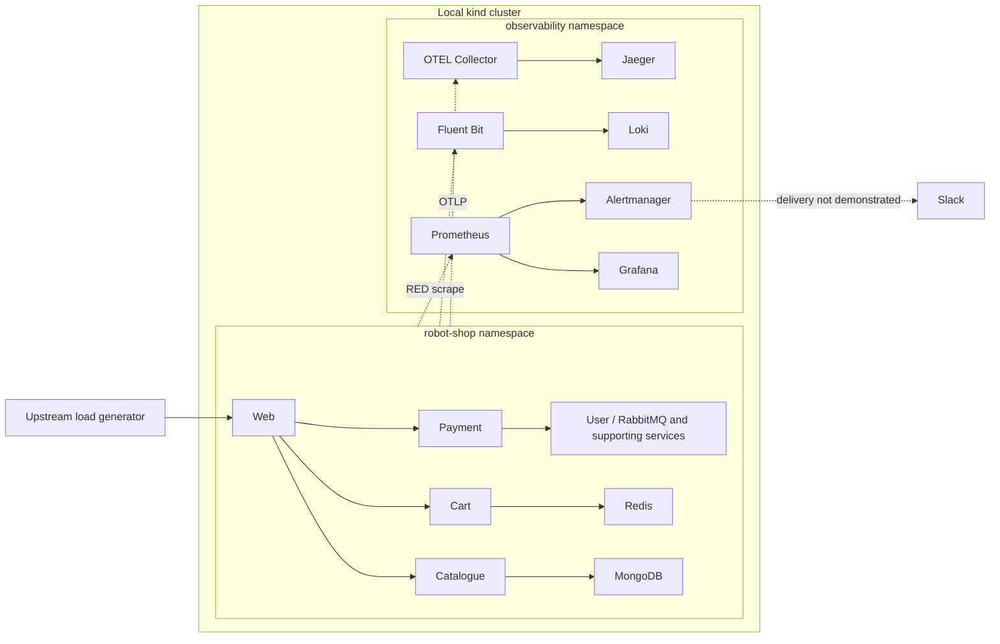

# Capstone 2 — Robot Shop observability demonstration

**Current submission entry point:** [SUBMISSION.md](SUBMISSION.md). Deadline:
October 27, 2026, 12:00 WAT (11:00 UTC).

Local builds and smoke tests are complete for Web, Catalogue, Cart and Payment.
Local kind installation is underway; no all-Ready, complete checkout, retrieved
successful checkout trace, delivered Slack alert or successful incident drill is claimed yet.
A genuine Catalogue HTTP `/health` trace was retrieved from Jaeger v3; see SUBMISSION.
Earlier preparation notes below are historical and must not override this checkpoint.

The demonstration reuses `kind-capstone-rollback-lab`, isolated in `robot-shop`
and `observability` namespaces. AWS and the production Voting App are untouched.
Local kind instead of the assignment's same AWS cluster is an explicit deviation:
the existing t3.medium cannot fit the combined stack safely.

## Current implementation

- [Adapted chart](robot-shop/) uses upstream snapshot
  `55292e2199f2fb00a165b1f7d3045fe7f8922038`; see [provenance](upstream-receipt.json).
  Full source archive is retained outside Git, selected source/license in this tree.
- [Local values](local-demo.values.yaml) enable locally built tags loaded into
  kind; production defaults continue to require immutable image digests.
  Payment uses its own health endpoint as a simulated gateway; no real financial
  transaction or real payment-site load is intended.
- [Cart/Catalogue build receipts](instrumentation/build-evidence.md) record
  dependency locks, Instana removal, RED and OpenTelemetry image tests.
- [Web adapter](local-services/web/) serves upstream static assets/API proxy with
  real RED metrics. [Payment](local-services/payment/) exports RED and OTLP HTTP.
  Both run non-root on8080 and have image smoke tests.
- [Monitoring local values](monitoring-local.values.yaml) target official
  kube-prometheus-stack **92.7.0**. [Auxiliary chart](observability/) supplies
  Fluent Bit, Loki, OTEL Collector, Jaeger, Blackbox and dashboard/alert configs.
- [SLO/error-budget policy](SLO.md) and [runbook](runbook.md) are prepared.
  No Slack delivery or incident outcome is claimed at this checkpoint.

This diagram describes configured connections, not proof they all work.
All four focus services export `http_server_requests_total{service,status}` and
`http_server_request_duration_seconds_bucket{service,le}`. Scrape/dashboard
integration requires real runtime evidence, not just middleware tests.

## Safety and further reference

Namespaces alone do not isolate shared CPU, memory or disk. Use bounded resources
and short telemetry retention. Keep AWS Voting App, its PostgreSQL PVC and its
Helm release untouched. Local cleanup must target only inventoried Capstone2
resources; do not blindly delete cluster-wide monitoring CRDs or other namespaces.

Earlier [configuration review](configuration-review.md),
[capacity assessment](capacity-assessment.md) and [deadline plan](deadline-readiness.md)
are historical preparation notes. Current submission claims are in the index above.
