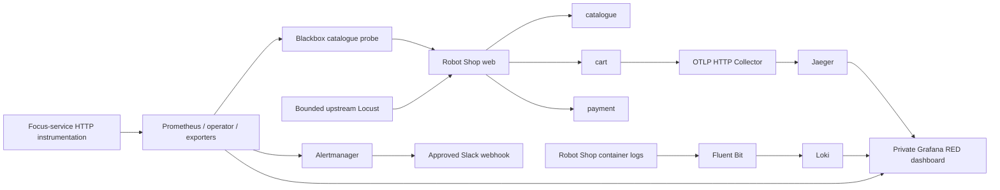

# Capstone 2 — deadline delivery receipt

2026-10-26. Local inspection only. This page is a submission roadmap, not evidence of a successful deployment. No credentials, infrastructure or Git history changed.

## Honest portfolio status

Robot Shop sources/chart are derived from upstream commit `55292e2199f2fb00a165b1f7d3045fe7f8922038`; receipt and Apache license are retained. The chart, private service/network design, auxiliary observability templates, dashboard draft, SLO and response runbook are prepared. Earlier offline contract checks are useful evidence only of rendered configuration relationships.

No Robot Shop deployment, shopping transaction, RED metrics, Loki ingestion, Jaeger trace, Slack delivery or incident recovery is verified. The owner explicitly accepted independent configurations and an independent drill because the instructor is unavailable. These alternatives must be disclosed in submission; references elsewhere to waiting for instructor files/drill are historical and superseded. Own-fork creation remains separately approved remote work.

## Actual remaining implementation gaps

| Area | Existing preparation | Shortest meaningful completion |
|---|---|---|
| Robot Shop | Twelve workload chart, digest guard and namespace isolation | Resolve all runtime pins; rehearse actual shopping flow and readiness; review default/EOL images without claiming scans passed |
| Prometheus/Grafana | kube-prometheus-stack values, blackbox dependency, seven dashboard panels | Pin and render the official chart; account for operator/exporters/reloaders/sidecars; validate exact versions and queries against emitted series |
| RED metrics | Dashboard expects `http_server_requests_total{service,status}` and latency buckets | Implement actual HTTP instrumentation for focus services or a validated per-service proxy metric source; blackbox latency is not service RED |
| Existing cart metrics | `prom-client` exposes `items_added` | This does not satisfy request/error/duration metric contracts |
| Logs | CRI tail path, bounded service/level labels, Loki configuration | Validate exact Fluent Bit/Loki images against representative logs; ingest/query real web/catalogue/cart/payment logs |
| Traces | OTLP HTTP collector and Jaeger 4318 linkage; cart/catalogue preparation script | Supply reviewed SDK version map and package locks, rebuild one service without Instana initialization, send one real request and record trace ID |
| Load | Original upstream load-gen source; supported-base Dockerfile | Create hash-locked requirements, build/scan, validate one-client checkout; retain Locust output rather than SILENT=1 when collecting evidence |
| Alerts | Slack Secret reference and mounted webhook path | Separately provision webhook/admin Secrets; verify actual firing and resolved delivery with accessible runbook URL |
| Incident | SLO/runbook and bounded failure proposal | Execute only after baseline evidence and explicit approval; write observed postmortem, never fill results in advance |

All five auxiliary image digest fields remain empty by design. The official monitoring chart is not pinned/rendered. `otel-versions.reviewed.json`, generated instrumented package locks and `loadgen-requirements.lock` are absent. These are build/runtime blockers, not documentation gaps. The trace SDK template currently exports traces only; it does not automatically implement the dashboard's RED metric names.

## Proposed architecture

Dependencies and actual request paths must be confirmed during rehearsal; arrows represent intended telemetry/business paths, not observed traces. Services stay private. Voting App and its PostgreSQL PVC are outside this lab's mutation scope.

## Capacity and temporary environment

Known loaded requests: Voting App 450m/608Mi; Robot Shop 1200m/1956Mi; four auxiliary components 200m/256Mi; Fluent Bit 50m/32Mi; Prometheus/Grafana/Alertmanager 175m/416Mi; load generator 50m/64Mi. Total **2125m CPU / 3332Mi memory**, excluding monitoring support and system overhead. Known aggregate memory limits are 6768Mi. Planning allowances add 300m/512Mi monitoring support and 500m/1024Mi system resources: **2925m/4868Mi**, before startup/surge/headroom. These are reservations/estimates, not measured usage.

The current 2-vCPU/4-GiB node is NO-GO for this declaration. A disposable local x86 Kubernetes VM with 4 CPU/12–16GiB and adequate disk is the fastest rehearsal candidate if the workstation can supply it; assess Docker Desktop allocation first. A same-cluster 4-vCPU/16-GiB node is a plausible production lab candidate, but requires live allocatable evidence, full monitoring render and approved capacity change. A separate temporary cloud environment protects production better but deviates from the assignment's same-cluster requirement and requires explicit disclosure/approval.

Do not present an exact cloud quote from incomplete configuration. The earlier indicative m7i.xlarge estimate is $0.2247/hour, about $2.25 for ten hours, excluding EBS/tax/transfer; current AWS pricing must be reverified before any approval. The node's existing PostgreSQL/root storage must never be replaced to satisfy this lab.

Budget sources: [existing component budget and caveats](capacity-assessment.md), [AWS EC2 On-Demand pricing](https://aws.amazon.com/ec2/pricing/on-demand/), [AWS T3 credit characteristics](https://aws.amazon.com/ec2/instance-types/t3/). No fresh quote was fetched in this document-only inspection. CPU requests do not consume credits; actual execution does. A credit-dependent instance is not equivalent to sustained non-burst CPU capacity.

## Deadline execution plan

1. **0.5–1 hour:** close artifact/image/chart inventory and local resource allocation; choose supported exact components. Stop if image registry access prevents reproducibility.
2. **2–4 hours:** implement and test actual focus-service RED instrumentation, one real OTEL SDK service and locked upstream load-gen. Legacy dependency compatibility may extend this considerably.
3. **1–2 hours:** pin/render/validate official monitoring chart and exact collector backends; run representative parser/config tests. Do not repeat already passed generic contract tests without changed inputs.
4. **2–3 hours:** separately approved disposable Kubernetes rehearsal: all twelve workloads, real shopping, RED panels, Loki service/level, trace, Slack. Reserve time for image pulls and startup troubleshooting.
5. **1 hour minimum after baseline:** bounded incident, detection, mitigation/recovery and actual timeline. Full rolling-hour SLO coverage requires at least one hour; collect it concurrently with baseline rehearsal.
6. **1–2 hours:** export evidence, queries, manifests/versions, screenshots and demo notes; accurately label missing proof.

Estimate **8–13 focused hours plus approvals/download delays** for a credible runtime demonstration if dependencies cooperate. No credible guarantee of completing both projects before the deadline while deployment and credential approvals remain absent. Prioritize Capstone 1's controlled release and a complete, smaller Capstone 2 proof over optional tracing links, burn-rate alerts, durable telemetry, public ingress or chaos frameworks.

## Independent incident and postmortem template

Proposed scenario: temporarily scale only Robot Shop catalogue to zero after recording its exact replica count and identity. This deliberately interrupts the catalogue probe and shopping flow without touching a database. Requires separate exact mutation/recovery approval. Maintain one low-rate client; do not combine with capacity stress. Restore the recorded catalogue replica count first, then investigate. Stop if Voting App regresses, node pressure appears, or recovery is uncertain. Never run this against Voting App.

Record actual values only:

- UTC injection / detection / acknowledgement / mitigation / recovery times: pending.
- User-visible impact and affected requests: pending.
- Alert firing/resolved URLs and screenshots: pending.
- PromQL, LogQL and real trace ID around failure: pending.
- Root cause: intentional catalogue unavailability; observed contributing factors: pending.
- Mitigation and recovery evidence: pending.
- SLO unavailable seconds and error budget consumed: pending.
- What helped/hindered, preventive action, owner and due date: pending.

Baseline acceptance requires actual all-workload health, successful load-gen checkout, all three RED signals, service/level log queries, one real request trace, firing/resolved Slack and Voting App unaffected. If any are missing, report partial completion rather than a PASS.
