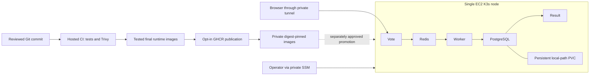

> Current closeout: [submission evidence and scope](../submission/README.md). The notes below are historical; they do not override the current matrix or authorize execution.

# Capstone 1 submission readiness

Updated October 26, 2026. Submission deadline: **October 27, 2026, 12:00 WAT (11:00 UTC)**.

This index supersedes stale completion claims in earlier preparation/audit notes.
It distinguishes recorded evidence from current live verification. No new AWS
operation or hosted run was performed while preparing this document.

## Submit these entry points

- Repository: [example-voting-app](https://github.com/akordonald15-hue/example-voting-app).
- [Main README](../README.md), [Helm chart](../helm/voting-app/README.md),
  [Terraform source and lifecycle instructions](../terraform/README.md).
- [Hosted publication run, attempt 2](https://github.com/akordonald15-hue/example-voting-app/actions/runs/40294083665/attempts/2).
- [Reviewed application changes, PR 1](https://github.com/akordonald15-hue/example-voting-app/pull/1)
  and [Node 24 artifact action correction, PR 2](https://github.com/akordonald15-hue/example-voting-app/pull/2).
- [Rollback procedure, exact fixture and evidence](rollback-evidence/README.md).
- [Robot Shop submission entry point](../capstone2/README.md); its runtime claims
  must be checked against its own evidence, not inferred from Voting App results.

Local submission preparation started from feature branch commit
`9c52a40ac193510e45917eb2f35ba0d29484cc4b`. Local work is not automatically
present on GitHub; confirm the final reviewed commit is uploaded before submitting
links to newly added files.

## Rubric and evidence

| Deliverable | Status and exact scope | Evidence |
|---|---|---|
| Docker Compose and hardened application images | Completed, previously verified; not rerun here | Dockerfiles in [vote](../vote/Dockerfile), [result](../result/Dockerfile), [worker](../worker/Dockerfile) |
| Terraform AWS/K3s provisioning | Working infrastructure reported; code and prior validation available | [Terraform source and instructions](../terraform/README.md) |
| Hosted tests and security scans | Recorded successful run: 13 guard tests, nine acceptance checks, three all-severity Trivy scans with zero findings at scan time | Hosted publication run above; downloadable acceptance/security artifacts |
| GHCR publication | Completed for source `bd9dfa3a2cf3bf27c893a3a7a64b81e8b7c00115`; tested image archives promoted without rebuilding | Hosted publish job and `release-values` artifact |
| AWS Helm application deployment | Owner-confirmed revision 2 deployed, five healthy workloads, private browser vote/result verification | Retain sanitized Helm status, pod status and browser evidence supplied by owner |
| Automatic CI-to-production deployment | **Not demonstrated**; deploy job skipped in successful publication run | [Workflow](../.github/workflows/capstone.yaml), limitations below |
| Helm rollback | **Completed only in isolated local Vote fixture** | [Rollback evidence](rollback-evidence/README.md) |
| Full production application rollback/PVC recovery | **Not demonstrated by the rollback fixture** | Do not substitute fixture screenshots for this claim |
| Terraform destroy/recreate | **Not demonstrated** | Source-only reproducibility instructions are not execution evidence |

Private images published for the recorded release:

| Image under `ghcr.io/akordonald15-hue/` | Immutable digest |
|---|---|
| `example-voting-app-vote` | `sha256:ad74a28ae9a2313f7eb5979d5c2eb51a89fb988e599ae4abf4d34d58c5f84c8b` |
| `example-voting-app-result` | `sha256:e049c330f4fada3747ad402892e99902221c9cb4e61f4865aab19d2f3d7fea99` |
| `example-voting-app-worker` | `sha256:591118792ba4c2e93b43fc8d1f1570b12cee35be5c229188827bd8771bdd3238` |

Publication is not proof those images are deployed in production. Push receipts
and release values agree; independent authenticated registry inspection and the
temporary Kubernetes pull test must have their own successful receipts before
being described as complete. A clean historic scan is not a future vulnerability guarantee.

## Architecture and CI/CD explanation

The pipeline builds each Dockerfile's `final` target, runs acceptance checks and
scans the resulting runtime images. Publication downloads the tested image
archive, tags the images with the full source SHA and records registry digests.
Publishing and deploying use separate opt-in variables. The dashed promotion
connection is a remaining delivery gate, not evidence of automatic deployment.

Production has no public application ingress or public Kubernetes access.
PostgreSQL local-path data is bound to the single node: Helm rollback does not
restore database contents, and instance destruction may destroy that data.

## Remaining CI-to-deployment limitations

- Do not register a production-capable runner on the public source repository:
  runner labels alone do not prevent untrusted workflows from scheduling it.
  A separately controlled private promotion boundary is needed before activation.
- Approval/environment protections, least-privilege Kubernetes access, private
  GHCR pull access and independent manifest verification remain deployment gates.
- Preserve healthy Helm revision 2 and the recovered PVC identity. An image-only
  update must pass live drift review; no automatic rollback or forced replacement.
- Keep production deployment disabled until separately approved. A manual
  operator release would not by itself satisfy an automated deployment rubric.

## Rollback evidence interpretation

The local `kind-capstone-rollback-lab` exercise installed a healthy Vote image,
introduced a deliberately invalid readiness path, observed revision 2 fail, and
manually rolled back to healthy revision 1, producing deployed revision 3.
The checked-in history, status, restored values and exact fixture are reproducible
evidence. It did not exercise Worker, Redis, Result, PostgreSQL or AWS rollback.
No production database or production release was modified by that demonstration.

## Final submission procedure

1. Submit the repository URL and this index, identify the exact submitted commit,
   and include the hosted run URL plus its retained acceptance/security artifacts.
2. Attach only genuine sanitized browser screenshots and Helm/pod evidence.
   Label owner-provided production evidence and local rollback evidence separately.
3. Include the rollback fixture, failure/rollback history and restored readiness
   result. Explicitly declare Terraform destroy/recreate and automatic production
   deployment incomplete unless later supported by real evidence.
4. Check reviewer access to the repository and private evidence. Do not make GHCR
   packages public or share credentials merely to ease review.
5. Exclude `.tfstate`, `.tfvars`, kubeconfigs, tokens, Slack webhooks, Secret data,
   private deployment bundles and unreviewed raw transcripts. Review every staged
   path; never use `git add .` for the submission.

The shortest safe closeout is an honest, linked evidence package. Do not destroy
working infrastructure or fabricate missing demonstrations to complete a checkbox.
