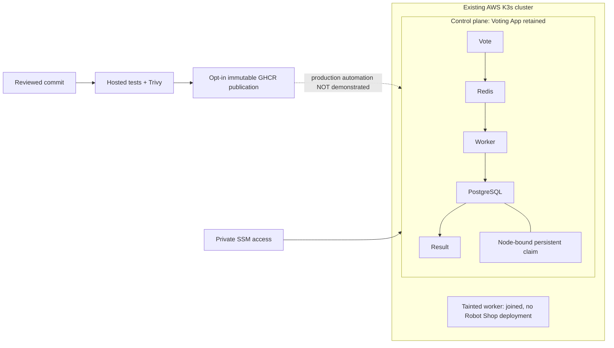
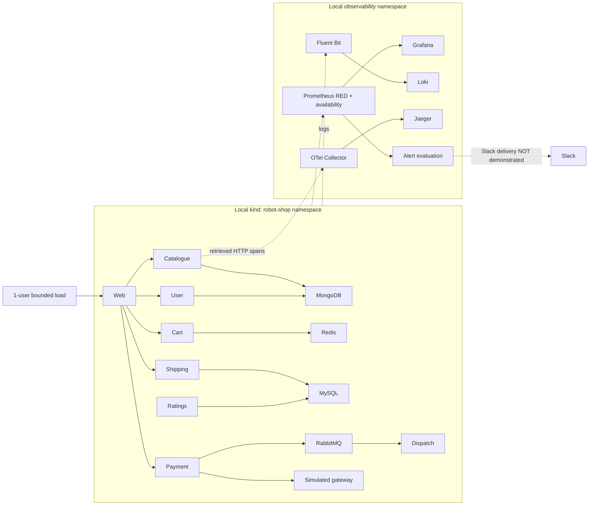

# Architecture — configured flows and demonstrated scope

## Capstone 1: AWS Voting App

Deployment health/join are owner-confirmed checkpoints. Solid arrows show application topology, not fresh tests during packaging. Persistent local-path data must not be deleted; worker does not make the single control plane highly available.

## Capstone 2: demonstrated local kind topology

Application checkout, metrics, selected logs/traces and local incident have separate receipts. Diagram arrows are not proof of complete distributed checkout tracing. AWS overlays describe a planned topology only. Existing upstream application image: [Voting App architecture](../architecture.excalidraw.png).
